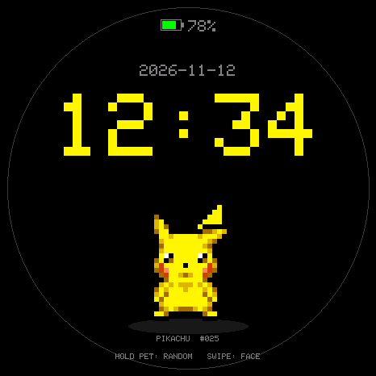
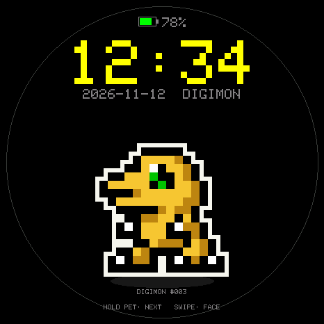
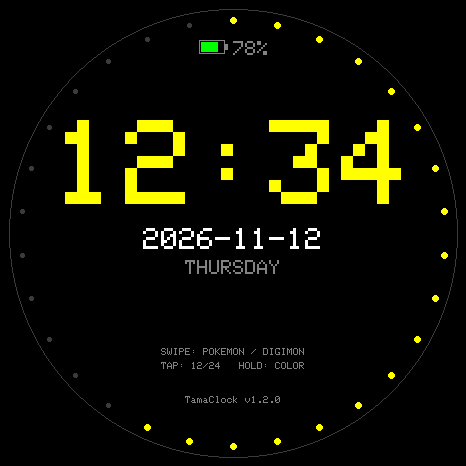

# TamaClock v1.2

Standalone clock for TamaHub v2. It uses the same PCF85063 the games keep
running, the AXP2101 for battery state and the CST9217 touch panel. Any 2 MB
`ota_*` slot works; the default layout puts it in `ota_3`.

## Controls

| Gesture | Action |
|---|---|
| Swipe up / down | Next / previous face: `DIGITAL` → `POKEMON` → `DIGIMON` |
| Long press on the creature (0.8 s) | Next creature in the pack (in list order) |
| Long press elsewhere (0.8 s) | Next theme colour |
| Tap | 12 / 24 hour |
| PWR short press | Screen off / on |
| BOOT short press | 12 / 24 hour (or wake) |
| BOOT hold 2 s | Save and return to TamaHub |

A short toast shows the new face or colour name. Everything (face, colour,
12/24 h, brightness) is stored in NVS namespace `tamaclock`, so it survives a
reflash that keeps NVS.

The ring is drawn at radius 224 on the 466 px panel, and every text row is
sized so its width stays inside the circle at that height. The old layout used
radius 196, which left the bottom help line outside the ring.

## Faces

| # | Face | Scene |
|---|---|---|
| 0 | `DIGITAL` | Large 12× time, date, weekday, battery, second ticks |
| 1 | `POKEMON` | Random Pokémon animation from `/tamapoke/mons` |
| 2 | `DIGIMON` | Random Digimon animation from `/tamadigi/mons` |
| 3 | `MARIO` | Parked for the later Game & Watch pass |
| 4 | `ZELDA` | Parked for the later Game & Watch pass |

MARIO/ZELDA keep their ids so an old NVS `face` still means what it meant, but
`FACE_LIVE` only steps through the three live faces. A saved 3/4 boots into
`DIGITAL`.

The digital layout: time y 120 (size 12), date y 228, weekday y 260, hints at
y 348/362 (size 1) and the version at y 396. Those rows keep every glyph corner
inside the radius-224 ring, and the block reads slightly above centre.

## Creature faces

The clock does **not** ship its own art. It reads the exact sprite files the
games already install on the card:

```
/tamapoke/mons/pNNN.bin    TPK2, dex 1..386 (sprites.pak + gen3 update)
/tamadigi/mons/pNNN.bin    TPK2, dex 1..87  (sprites-ver1..5.pak)
```

So if the game shows a sprite, the clock shows the same sprite. Shiny files
(`psNNN.bin`) are skipped: they duplicate a normal entry.

- On entering a face the folder is scanned once and a random creature is
  loaded. Only the `IDLE` action is used, one creature in PSRAM at a time.
- The creature changes every **5 minutes** (`MON_SWAP_MS`) to another random
  entry. A long press on it moves to the next entry immediately, which makes
  the gesture easy to see.
- Scale is computed from the sprite's visible height (not its padded canvas),
  anchored by the lowest used row, then clamped to 400 × 245 px so wide
  sprites still fit inside the ring.
- If the card is missing, the folder is empty or a file is unreadable, the
  built-in `scenes::poke/digi` drawing plays and the row reads
  `NO SPRITES ON SD`. The clock never shows an empty hole.

Layout: date + face name y 80 (size 2) above the dial, time y 116 (size 11),
battery at y 24, shadow line at y 398, `POKEMON #025` / `DIGIMON #003` label
y 416, hint `HOLD PET: NEXT   SWIPE: FACE` y 438 (all size 1). The time is
drawn in the creature's main colour (`MonsPack::pickAccent`), so the hands
change colour with the creature; a dark winner is brightened until it reads.
See
`tools/render_clock_preview.py`, which decodes the real TPK2 files and draws
the same coordinates with the Arduino_GFX 5×7 font. Its output lives in
`docs/preview/`.

Upload the sprites from the TamaHub installer while the matching game is
running (Web Serial): TamaPoke for Pokémon, TamaDigi for Digimon. The clock
itself has no uploader.

Previews rendered from the real packs (same font, same coordinates):

| Pokémon | Digimon |
|---|---|
|  |  |



Regenerate them with `python tools/render_clock_preview.py` after a layout
change; `--pokemon` / `--digimon` pick another dex number.

### Parked TNM packs

`clockpack.h` (the old `TNM1` animation pack loader) and the procedural scenes
in `scenes.h` stay in the tree. They are unused by the live faces and are kept
for the Game & Watch pass.

## Date: why the games' clock and the date differ

TamaPoke seeds a virgin RTC with a fixed date (`1767225600`, 2026-01-01) because
it only compares elapsed time. The RTC therefore holds a valid *time of day* but
a meaningless *date*; this is why the clock used to show `2026-01-02`.

TamaClock keeps the RTC untouched (changing it would make the games apply a
large offline-progression jump) and adds a whole-day display offset:

```
offset = (build date) − (RTC date), in whole days
```

The offset is recomputed whenever the firmware build stamp changes, so
reflashing fixes the date again. Because it is a whole number of days the
displayed time of day stays exactly the RTC time the games maintain.

- `AUTO` — recompute the offset from the build date now.
- `REAL` — clear the offset (display follows the RTC exactly).
- `SET=YYYY-MM-DD HH:MM:SS` / `TIME=<epoch>` — move only the displayed clock.

The build date is used, not the flash date. If you flash a build made days
earlier, run `SET=` once (or rebuild) to correct the remaining days.

## Battery

The top row shows an icon plus percentage. The icon is green above 30 %, orange
down to 15 %, red below that; with USB power the cell turns green and a small
bolt is drawn. The PMU is sampled every 5 s, which is also the status the games
cache.

## Sleep

`PWR` short press blanks the panel (`displayOff`) without touching the RTC,
Wi-Fi or NVS; touch, `PWR`, `BOOT`, `WAKE` or any serial traffic wakes it. The
AXP2101 is configured so a 4-second PWR hold still powers the board off.

## Serial (115200)

```
STATUS
SET=YYYY-MM-DD HH:MM:SS
TIME=<epoch>
12H | 24H
AUTO | REAL
FACE=0..2 | FACE=NEXT | FACE=PREV   (MARIO/ZELDA are parked and skipped)
COLOR=0..6 | COLOR=NEXT
BRIGHT=1..255
SLEEP | WAKE
SHOW          force a redraw
SD            remount the card and rescan the sprite folder
MON=NEXT      next creature in the pack
MON=RANDOM     random creature now
MON=RELOAD    rescan the folder and pick a random creature
```

`STATUS` reports the current creature as `mon=<position>/<count>(FACE) ok=1`,
so a sprite that failed to load is visible without a screen.
